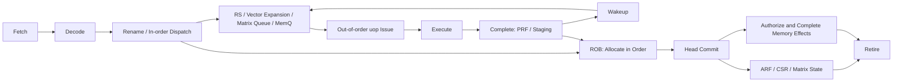

# XJ-NPU Architecture

- **Author:** Calcifer
- **Revision Date:** 2026-11-01
- **Architecture Baseline:** XiangJiang NPU V1


## 1. Architecture Overview

XiangJiang NPU 是面向机器学习模型推理的单指令流硬件加速器。它使用统一指令前端组织标量、向量和矩阵计算，以软件管理的片上 SRAM 保存程序与工作数据，并通过 DMA 与 Host DDR 交换张量。

### 1.1. 架构特点

- **统一的 XJ-ISA。** 采用 RISC-V 的基础编码和执行语义，选取推理计算与控制流程需要的标量、浮点和向量指令，增加矩阵扩展 `Xxjmatrix` 与数据搬运扩展 `Xxjdma`。
- **标量、向量、矩阵协同。** 标量单元负责地址计算、循环和分支；向量单元负责逐元素计算、归约与数据重排；矩阵单元负责分块矩阵乘法和乘累加。
- **统一前端、单宽派发。** 每周期最多按程序顺序派发一条架构指令。向量指令可在后续周期展开为多个 micro-operation（uop），共享同一个 ROB Entry。
- **In-Out-In 执行模型。** 架构指令顺序派发，后端 uop 按依赖就绪情况乱序发射、执行和完成，架构状态通过 ROB 按程序顺序提交。
- **寄存器重命名。** X、F、V 三个寄存器命名空间分别维护 RAT、PRF 和 ARF；未提交计算结果与已提交程序状态分离。
- **128-bit 向量数据通路。** 默认 `VLEN=128`、`DLEN=128`、`ELEN=32`，支持 8/16/32-bit 整数与定点元素，以及 FP32 元素。更宽的寄存器组通过多个 uop 执行。
- **三个 8×8 脉动阵列。** 一个 BF16 矩阵单元使用 FP32 累加器，两个有符号 INT8 矩阵单元使用 INT32 累加器。独立任务在资源与依赖允许时可并行计算。
- **软件管理的 TCM。** 配置 256 KiB ITCM 和 1 MiB DTCM。DTCM 分为四个 256 KiB bank；TCM 不包含 Cache tag、缺失处理或替换逻辑。
- **统一访存顺序。** 标量、浮点、向量、矩阵和 DMA 访存统一进入 MemQ。基线每次执行一个架构访存任务；写入操作必须获得 ROB Head 授权。
- **二维 DMA。** 支持按行长度、行数与内外存步长搬运张量；基线只有一个活动命令和一个未完成的 AXI burst。
- **Host 管理。** Host 通过 AXI4-Lite 配置与启动 NPU，通过 AXI4 Slave 装载程序和访问片上数据；NPU 通过 AXI4 Master 主动访问 Host DDR。
- **精确故障边界。** 故障在 ROB Head 对外报告。更老指令已提交，更年轻指令不得提交；Host 读取故障状态后负责处理和重新启动。

### 1.2. 基线参数

| 参数 | 基线值 |
| --- | --- |
| 整数宽度 `XLEN` / 浮点寄存器宽度 `FLEN` | 32 bit / 32 bit |
| 指令长度 / 指令对齐 | 32 bit / 4 B |
| 架构指令派发宽度 | 最多 1 instruction/cycle |
| 提交宽度 | 同时处理 1 个 ROB Entry；多目标或有副作用的指令可占用多个周期 |
| `VLEN` / `DLEN` / `ELEN` | 128 / 128 / 32 bit |
| 矩阵阵列 | 3 × 8×8，每阵列 64 个 PE |
| ITCM / DTCM | 256 KiB / 1 MiB |
| DTCM bank | 4 × 256 KiB；每 bank 为 512-bit、1R1W |
| DMA 并发 | 1 个活动命令，最多 1 个未完成 AXI burst |
| AXI 外存地址 / 默认数据宽度 | 32 bit / 32 bit |

ROB、RS、PRF、MemQ 和向量展开队列的深度，以及各功能单元流水线延迟，属于实现参数。功能单元数量和数据通路宽度不直接等同于持续吞吐率；吞吐率还受依赖、访存顺序、仲裁与提交阻塞影响。

## 2. Instruction Set

### 2.1. XJ-ISA 的组成与声明边界

XJ-ISA 基于 RISC-V 编码和语义，选取推理计算及控制流程所需指令，并增加矩阵和数据搬运扩展。

| 指令来源或扩展 | 参考版本 | 用途 |
| --- | --- | --- |
| RV32I | 2.1 | 整数运算、访存、控制流和环境指令 |
| M | 2.0 | 整数乘法、除法和求余 |
| F | 2.2 | 标量 FP32 运算；采用部分指令 |
| Zicsr | 2.0 | CSR 读取、修改和写入 |
| Zifencei | 2.0 | 指令存储与后续取指同步 |
| Zbb | 1.0 | 标量位操作 |
| Zve32f | 1.0 | 8/16/32-bit 整数与定点向量运算、FP32 向量运算；选取与 Transformer 推理相关的指令 |
| Xxjmatrix | 自定义 | 矩阵装载、计算、存储和同步 |
| Xxjdma | 自定义 | DMA 配置、传输和同步 |

表中的标准扩展名称表示指令来源。F 与 Zve32f 的选集必须以逐条指令支持表发布，不能仅凭采用标准编码就声明完整扩展兼容。标准 Zve32f 依赖 F，并有必需指令集合；在完整依赖、指令和异常语义补齐前，不应将 `rv32imf_zve32f_zicsr_zifencei_zbb` 作为已实现能力字符串。[RISC-V Vector 1.0：Zve 扩展](https://docs.riscv.org/reference/isa/v20260120/unpriv/v-st-ext.html)

本设计的标准整数基线为 `rv32im_zicsr_zifencei_zbb`，浮点和向量选集由 XJ-ISA 的能力说明补充。基线不声明 A、C、D、RISC-V Privileged ISA、MMU 或虚拟内存。

### 2.2. 标量指令

**整数与控制指令。** RV32I 用于整数算术、逻辑、移位、比较、地址生成、Load/Store、条件分支、`JAL/JALR`、`FENCE` 和环境事件。M 提供 `MUL/MULH/MULHU/MULHSU` 与 `DIV/DIVU/REM/REMU`。Zbb 提供基础位操作。各指令保留所选标准定义的边界语义，例如整数除零产生标准规定的结果，而不是自动触发算术异常。

**标量 FP32 选集。** 采用 `f0–f31`、F 扩展编码和 IEEE 754 binary32 格式，目标范围如下。

| 类别 | 指令范围 |
| --- | --- |
| 浮点访存 | `FLW`、`FSW` |
| 基本计算 | `FADD.S`、`FSUB.S`、`FMUL.S` |
| 比较 | `FEQ.S`、`FLT.S`、`FLE.S` |
| 数值转换 | `FCVT.W.S`、`FCVT.WU.S`、`FCVT.S.W`、`FCVT.S.WU` |
| 位模式搬运 | `FMV.X.W`、`FMV.W.X` |

100 MHz 实现裁剪 `FMADD.S/FMSUB.S/FNMSUB.S/FNMADD.S/FDIV.S/FSQRT.S`，
矩阵 MAC 保留；软件替代的精度边界见 [时序实现说明](XJ-TIMING-100MHz.md)。
未纳入选集的编码按 Illegal Instruction 处理。浮点运算采用指令给定的舍入模式，或派发时确定的 `frm` 快照；候选异常标志随结果保存到 ROB，在提交时更新 `fflags`。浮点异常标志本身不自动触发同步 trap。[RISC-V F 2.2](https://docs.riscv.org/reference/isa/v20260120/unpriv/f-st-ext.html)

### 2.3. 向量指令

向量选集围绕推理中的逐元素运算、量化处理、归约和数据重排组织：

| 类别 | 功能 | 推理用途示例 |
| --- | --- | --- |
| 配置 | `vsetvli`、`vsetivli`、`vsetvl` | 设置元素宽度、向量长度和寄存器组 |
| 整数与定点 | 加减、移位、比较、饱和、窄化、乘法和 MAC | 量化、反量化辅助处理、定点缩放 |
| FP32 | 加减乘、比较、转换；除法/开方由软件近似或软件精确例程实现 | 逐元素运算、归一化和激活函数中的基础计算 |
| 归约与掩码 | 求和、最大/最小、掩码生成和统计 | Softmax 与归一化中的归约步骤 |
| 重排 | Gather、Slide、Compress、索引生成 | 数据布局调整和索引选择 |
| 访存 | 连续、跨步、索引、分段及其他选定形式 | 张量片段装载与存储 |

这些类别描述功能覆盖方向，具体 opcode、SEW、LMUL、EMUL、寄存器重叠和异常行为必须在指令白名单中逐项固定。Softmax、GELU 等由软件组合基础操作实现；本文未定义专用 `exp`、`tanh` 或 GELU 指令。

执行约束如下：

- `VLEN` 是单个架构向量寄存器宽度，`DLEN` 是单个执行切片宽度，`ELEN` 是最大元素宽度。
- 当寄存器组或操作的有效宽度超过 `DLEN` 时，指令展开为多个 uop。`VLEN=DLEN=128`、LMUL=1 的普通逐元素算术通常只需要一个数据通路切片。
- 在 `ELEN=32` 的基线中，整数 widening 操作必须满足输入和结果元素宽度限制；不包含 32→64-bit widening 或 FP32→FP64 操作。
- 每条已派发指令携带固定的 `vl/vtype/vstart/vxrm/frm` 等相关配置快照，以及必要的 mask 和旧目标版本。
- `vset*` 由配置单元执行，不进入向量算术阵列；`vl/vtype/vstart` 与整数 `rd` 在提交点统一发布。后续向量指令等待配置提交。
- 合法 `vset*` 请求不支持的 `vtype` 时，按所采用的标准规则设置 `vill`、更新 `vl`；这与指令本身编码非法需要分别处理。
- Matrix BF16 能力不自动赋予标量或向量 BF16 指令能力。

**本稿建议的配置依赖补充：** 除显式配置指令外，隐式改变后续执行上下文的操作也需要排序。当一条指令使用非零 `vstart`，或某条已选入的 fault-only-first 指令可能更新 `vl` 时，阻止相关年轻向量指令派发直到该更新提交，避免连续指令捕获已过时的配置。

**向量异常待定义项。** V2 材料同时提出整条指令提交和可恢复向量故障。若支持按 `vstart` 恢复，必须在故障边界保留规范要求的已完成元素，不能丢弃全部结果后仅记录非零 `vstart`；fault-only-first 还需要专门的 `vl` 更新规则。相关指令只有在这些规则冻结后才能纳入已支持白名单。[RISC-V Vector 1.0：精确向量异常](https://docs.riscv.org/reference/isa/v20260120/unpriv/v-st-ext.html)

### 2.4. 矩阵扩展 Xxjmatrix

| 指令 | 功能 |
| --- | --- |
| `MSETMODE` | 设置指定 INT8 单元的 OS/WS 模式；BF16 单元仅允许 OS |
| `MLOAD.A` | 从 DTCM 装载完整 A tile |
| `MLOAD.B` | 从 DTCM 装载完整 B tile |
| `MLOAD.ACC` | 从 DTCM 装载累加器初始值 |
| `MMUL` | 清零工作累加器并计算 `ACC=A×B` |
| `MMACC` | 以已提交 ACC 为初值，计算 `ACC=ACC+A×B` |
| `MEW` | 逐元素乘法，生成新的 ACC |
| `MTRANS` | 将 A 转置后转换到 ACC 数据格式 |
| `MSTORE` | 将已提交 ACC 按规定格式写入 DTCM |
| `MBARRIER` | 等待更老的 Matrix/DMA 任务完成，阻止年轻相关任务越过 |
| `MFENCE` | 建立 Matrix/DMA 访存的完成与可见性顺序 |

矩阵输入、累加器和模式使用独立的矩阵架构状态。每条矩阵指令均分配 ROB Entry，计算或装载结果先保存在带标签的临时状态，随后在 ROB Head 发布。

### 2.5. 数据搬运扩展 Xxjdma

| 指令 | 输入 | 功能 |
| --- | --- | --- |
| `DSETSIZE` | 两个 X 源操作数 | 设置每行字节数 `row_bytes` 与行数 `rows` |
| `DSETSTRIDE` | 两个 X 源操作数 | 设置 `external_stride` 与 `local_stride` |
| `MVIN` | 外存地址、DTCM 地址 | Host DDR → DTCM |
| `MVOUT` | 外存地址、DTCM 地址 | DTCM → Host DDR |

配置指令在 ROB Head 更新已提交 DMA 配置。`MVIN/MVOUT` 在派发时捕获地址操作数或依赖标签，以及已提交的完整配置快照；执行途中不重新读取可能已经变化的架构寄存器。

基线 DMA 传输获得 ROB Head 授权后启动，并占据 ROB Head 直至完成或错误处理结束，因此它们不是“发出即退休”的异步命令。DMA 同步使用 `MBARRIER`、`MFENCE` 或通用 `FENCE`，不额外假设未定义的等待指令。

自定义指令的 opcode、字段布局、汇编操作数顺序及保留位处理仍需独立编码表固定；本文中的助记符表示操作类别。

### 2.6. 屏障指令的作用域

| 指令 | 排序范围与完成条件 |
| --- | --- |
| `FENCE` | 保守全局访存屏障；等待相关更老 MemQ、Store、Matrix/DMA 访存和外部响应完成 |
| `FENCE.I` | 同步允许影响指令存储的更老写入，刷新取指状态，再从下一条指令取指 |
| `MBARRIER` | Matrix/DMA 任务执行屏障 |
| `MFENCE` | Matrix/DMA 内存可见性屏障，覆盖 DTCM 写完成和相关 AXI 响应 |

`FENCE.I` 不替代 Host CPU 的数据 Cache 维护，也不自行建立跨设备缓存一致性。[RISC-V Zifencei 2.0](https://docs.riscv.org/reference/isa/v20260120/unpriv/zifencei.html)

## 3. Functional Units

### 3.1. 标量功能单元

| 功能单元 | 数量 | 设计职责 |
| --- | ---: | --- |
| Integer ALU | 1 | 整数加减、比较、逻辑、移位和 Zbb 位操作 |
| Branch Unit | 1 | 条件分支、JAL/JALR、目标生成与合法性检查 |
| MLU | 1 | 整数乘法及乘积高位计算 |
| DVU | 1 | 有符号/无符号除法与求余 |
| FloatCore | 1 | 所选标量 FP32 运算 |
| Scalar AGU | 1 | 标量整数与浮点访存地址生成 |
| CSR/Configuration Unit | 1 | CSR 与 Vector/Matrix/DMA 配置处理 |
| Commit/Fault Controller | 1 | 顺序提交、故障记录、Flush 与 Host 通知 |

ADD/SUB 共享加法器。整数乘法与除法由于数据通路、延迟及流水结构不同，使用独立单元。100 MHz 实现中 FloatCore 共享加减流水通路，设置独立乘法流水通路，移除标量 FMA/div/sqrt 硬件；保留运算的舍入语义不因切流水改变。整数 MLU 3 周期，DVU 34 周期，FloatCore 6 周期，均不包含发射等待与写回反压。

### 3.2. 向量功能单元

| 功能单元 | 数量 | uop 分类 | 设计职责 |
| --- | ---: | --- | --- |
| VALU | 1 | `VEU_ALU`、`VEU_CMP` | 整数/定点算术、逻辑、移位、饱和、窄化和比较 |
| VMUL/MAC | 1 | `VEU_MUL`、`VEU_MAC` | 整数乘法、合法宽度的 widening、乘加和定点乘法 |
| VDIV | 1 | `VEU_DIV` | 整数除法和求余 |
| VFALU | 1 | `VEU_FCVT/FNCMP/FCMP/FTBL` | 所选 FP32 加减乘、转换、min/max、比较；浮点 FMA/div/sqrt 已裁剪 |
| PMTRDT | 1 | `VEU_PMT/RDT/FRDT/MISC` | 重排、整数/FP32 归约、掩码统计和索引生成 |
| Vector LSU Sequencer | 1 | `LSU` | 将选定向量访存分解为元素、分段和 beat 请求 |

表中 uop 分类为内部执行分类，不是额外 ISA 扩展。不同类型的 FU 可以并行执行，但归约、重排、除法等操作可能需要多个周期，不能由 128-bit 宽度推导为所有操作每周期完成一次。

每个 VPRF Entry 保存一个完整 `VLEN`-bit 版本。LMUL 寄存器组可能需要多个 VPRF Entry，派发时必须一次性分配齐全。对于要求保持旧值的 mask/tail 元素，重命名阶段捕获旧目标版本；全部切片和合并结束后，该物理寄存器才置为 ready。

### 3.3. 矩阵功能单元

#### 3.3.1. 阵列组织

| 单元 | 阵列 | A / B Buffer | 输入格式 | 数据流 | 内部累加器 |
| --- | --- | --- | --- | --- | --- |
| MU0 | 8×8，64 PE | M0 / M1 | BF16 | OS | `ACC0: FP32[8][8]` |
| MU1 | 8×8，64 PE | M2 / M3 | Signed INT8 | OS / WS | `ACC1: INT32[8][8]` |
| MU2 | 8×8，64 PE | M4 / M5 | Signed INT8 | OS / WS | `ACC2: INT32[8][8]` |

Matrix LSU 将 DTCM 中的 tile 装入输入缓冲区。Skew/routing 逻辑安排操作数的时间与空间对齐，使同一 K 位置的 A、B 在对应 PE 相遇。OS（Output Stationary）保持输出部分和驻留，WS（Weight Stationary）保持权重驻留；模式切换改变内部映射与路由，软件可见的结果仍为 A×B。

结果保存在专用累加器中，通过 `MSTORE` 写回 DTCM；不直接写入 X、F 或 V Register File。`MEW` 与 `MTRANS` 可通过阵列的专用控制和重排路径执行，不要求每种操作都经过矩阵乘法的全部流水阶段。

#### 3.3.2. INT8 数值语义

每个 PE 执行：

```text
product_int16 = signed_int8(A) × signed_int8(B)
acc_int32     = wrap_int32(acc_int32 + sign_extend_int32(product_int16))
```

`MMUL` 清零工作累加器；`MMACC` 保留已提交部分和并继续累加。INT32 溢出按二进制补码回绕；存储时保留 INT32，不自动饱和或窄化为 INT8。量化输出由后续软件操作显式完成。

#### 3.3.3. BF16 数值语义

MU0 沿用 V2 定义的自定义 BF16 乘积舍入、FP32 累加语义：

```text
product_bf16 = RNE_BF16(A × B)
acc_fp32     = RNE_FP32(acc_fp32 + exact_widen_FP32(product_bf16))
```

每次乘积先舍入到 BF16，再精确拓宽到 FP32 参与加法。这个中间舍入点会影响模型精度，软件参考模型必须显式复现，不能直接使用 BF16×BF16→FP32 widening FMA 作为等价实现。

- 舍入固定为 Round to Nearest, Ties to Even（RNE），不读取标量 `frm`。
- BF16 与 FP32 支持 signed zero、subnormal、Infinity 和 NaN；采用 gradual underflow。
- 矩阵 NaN 结果规范化为 BF16 `0x7FC0` 或 FP32 `0x7FC00000`；无效运算如 `Inf×0` 产生 quiet NaN。
- 有限值溢出产生相应符号的 Infinity；矩阵运算不更新标量 `fflags`。
- `MMUL` 清零工作 ACC；`MMACC` 保留已提交 FP32 部分和。
- `MLOAD.ACC` 将外部 BF16 数值拓宽到 FP32；`MSTORE` 将 FP32 按 RNE 转回 BF16，并应用上述特殊值规则。

跨 K tile 的高精度部分和应保持在内部 FP32 ACC 中；将 ACC 存为 BF16 后再装回会引入精度损失。

#### 3.3.4. 逐元素乘法与转置

| 操作 | BF16 单元 | INT8 单元 |
| --- | --- | --- |
| `MEW` | 每个乘积舍入为 BF16，再拓宽到 FP32 ACC | 每个 INT16 乘积符号扩展到 INT32 ACC |
| `MTRANS` | `A[j][i]` 拓宽为 FP32 后写入 `ACC[i][j]` | `A[j][i]` 符号扩展为 INT32 后写入 `ACC[i][j]` |

#### 3.3.5. 矩阵状态与依赖管理

矩阵状态分为三类：

| 状态 | 内容 | 生命周期 |
| --- | --- | --- |
| Committed State / MASF | 输入 tile、ACC、mode | 仅在 ROB Head 更新，故障恢复时保留 |
| Staging / Working State | 装载暂存、计算结果、owner ROBTag、错误状态 | 供未提交指令使用；取消时丢弃 |
| Physical Transient State | PE 流水寄存器、wavefront 计数器、路由控制 | 执行过程内部状态 |

基线不实现 RAT-M。Scoreboard 分别跟踪每个单元的 A、B、ACC、MODE，包括 writer tag、reader 占用和 staging owner。每个逻辑资源最多存在一个未提交 writer。

Reader 等待更老 writer 提交后读取 committed state；读取期间必须捕获操作数或保持资源占用，防止后续覆盖。不同矩阵单元可以重叠计算，共享的 Matrix LSU、DTCM 端口或任务记录仍可能导致停顿。

### 3.4. 访存与数据搬运单元

访存系统由 Scalar AGU、Vector LSU Sequencer、Matrix LSU Sequencer、DMA Local Path、统一 MemQ 和 DTCM Bank Arbiter 组成。各计算单元的访存请求通过统一顺序控制访问 DTCM。

Matrix LSU 传输完整 tile；DMA Engine 负责外存 burst 与片上 64-byte beat 之间的宽度转换、缓冲和错误处理。基线普通 Scalar/Vector/Matrix Load/Store 只访问 DTCM，外存访问统一由 DMA 执行。

### 3.5. 功能单元的完成接口

功能单元使用带反压的请求与完成接口。完成记录至少关联 `ROBTag`、`uop_index`、目标资源、结果和异常信息。完成端未被接收时保持记录稳定。

普通计算结果写入 PRF，矩阵结果写入带标签的工作状态，候选 CSR/配置状态记录于 ROB 或专用控制记录。Completion 负责唤醒消费者和记录执行完成；架构状态由第 6 章的提交逻辑统一发布。

## 4. Memory Hierarchy

XiangJiang NPU 的工作数据路径为 **Register File / Matrix State ↔ DTCM ↔ DMA Engine ↔ Host DDR**。ITCM 单独承载指令流。DMA Engine 是片上存储与外存之间的搬运通路，不是具有独立存储容量的层级。

```text
指令路径
Host ── S_AXI_MEM ──> ITCM ──> Fetch / Decode

工作数据路径
X/F/V Register File ── Scalar / Vector LSU ──┐
                                            ├── DTCM ↔ DMA Engine ↔ M_AXI_EXT ↔ Host DDR
Matrix Buffer / ACC ── Matrix LSU ──────────┘
                                              ↑
                                  Host ── S_AXI_MEM（仅空闲时）
```

### 4.1. Register File 与矩阵状态

| 存储资源 | 组织 | 用途 |
| --- | --- | --- |
| Integer ARF | 32 × 32 bit | 已提交整数、地址和控制状态；`x0=0` |
| Floating-Point ARF | 32 × 32 bit | 已提交 FP32 状态；`f0` 可正常写入 |
| Vector ARF | 32 × VLEN bit；默认 512 B | 已提交向量状态；`v0` 也可作为 mask |
| X/F/V PRF | 独立物理寄存器池，数量可配置 | 未提交结果和依赖传递 |
| M0/M1 | 每个 8×8 BF16，128 B | MU0 的 A/B 输入 |
| M2–M5 | 每个 8×8 INT8，64 B | MU1/MU2 的 A/B 输入 |
| ACC0–ACC2 | 每个 8×8×32 bit，256 B | FP32 或 INT32 部分和 |

矩阵表中容量只计算逻辑已提交数据，未包含 staging、working、skew 流水和控制开销。PRF 容量也不属于架构寄存器容量。

### 4.2. ITCM

| 属性 | 定义 |
| --- | --- |
| 容量 | 256 KiB |
| Core 地址 | `0x00000000–0x0003FFFF`，字节地址 |
| 最后一个合法 32-bit 指令地址 | `0x0003FFFC` |
| SRAM 组织 | 32-bit、单端口、同步 SRAM |
| 运行时访问方 | Core Fetch |
| Host 访问 | 仅空闲时装载程序或读回 |

在周期 N 接受读请求，周期 N+1 返回指令。PC 在转为 SRAM 索引前必须完成对齐和范围检查，禁止通过截断地址产生回绕。

运行期间 Core 独占 ITCM 端口。`FENCE.I` 在提交点刷新预取和取指响应状态；即使平台禁止运行期写 ITCM，也保留该合法序列化操作。复位不要求擦除 ITCM 内容，新任务必须保证所需程序已装载。

### 4.3. DTCM

| 属性 | 定义 |
| --- | --- |
| 总容量 | 1 MiB |
| Bank 数量 / 单 bank 容量 | 4 / 256 KiB |
| 单 bank 端口 | 1 个 512-bit 读端口与 1 个 512-bit 写端口，1R1W |
| Beat / Byte Enable | 64 B / 64 bit |
| Core 数据地址 | `0x00000000–0x000FFFFF` |
| 交织粒度 | 64 B |

对 DTCM 零基字节地址 `a`：

```text
byte_in_beat = a[5:0]
bank         = a[7:6]
row          = a >> 8
```

同一 bank 的多个读请求或多个写请求需要仲裁。同一 row 的读写冲突按确定规则串行处理，不依赖 SRAM 未定义的 read-during-write 行为。

DTCM 同样采用请求接收后下一周期返回读数据的同步 SRAM 语义。仲裁、bank 冲突、多 beat 操作和宽度转换会增加整体访问延迟，因此“SRAM 一周期读延迟”不等于“任意 Load 一周期完成”。

### 4.4. Tile 布局

矩阵 tile 在 DTCM 中按 row-major 连续存放，地址至少 64-byte 对齐。Matrix LSU 按地址递增顺序传输 64-byte beat，在发出第一个请求前检查完整 tile 的对齐与范围。

| 单元 | A/B 每个 tile | `MLOAD.ACC` / `MSTORE` 的外部格式 | ACC 外部字节数 |
| --- | --- | --- | ---: |
| MU0 | 8×8 BF16，128 B | 8×8 BF16；内部累加为 FP32 | 128 B |
| MU1 / MU2 | 8×8 INT8，64 B | 8×8 Signed INT32 | 256 B |

矩阵输入格式、内部累加格式和外部输出格式分别定义；不能根据输入 INT8 推断输出也为 INT8。

### 4.5. 统一访存队列 MemQ

所有 Scalar、FP、Vector、Matrix 和 DMA 访存按架构派发顺序分配 MemQ Entry。Entry 保存 owner ROBTag、年龄、操作类型、地址/数据依赖、配置快照、byte enable、进度、异常和完成状态。

基线调度规则：

1. 任一时刻最多一个 MemQ Entry 处于 active 状态，只有队首可以启动新访存。
2. 无读取副作用的普通 Load 在成为 MemQ Head 后可早于 ROB Head 执行。
3. Store、`MSTORE`、`MVIN`、`MVOUT` 必须同时位于 MemQ Head 和 ROB Head，完成必要预检查后才能启动不可逆操作。
4. 当前多 beat 任务完成或完成错误排空前，后续 MemQ Entry 不启动。
5. 不实现 Load 越过、Store-to-Load forwarding、地址推测或 memory replay。
6. 无活动元素的向量访存不发出数据请求，但仍按顺序完成相应架构操作。

Load 成功要求全部活动数据返回、无错误、目标合并完成且全部目标 PRF ready。Store 成功要求全部活动字节达到规定的可观察完成点。Host 在运行期间不能通过 Slave 接口并发修改 ITCM/DTCM，从而避免绕过 MemQ 的访问顺序。

### 4.6. DMA Engine

#### 4.6.1. 二维搬运

DMA 使用四个配置参数和两个基地址。第 `r` 行的搬运范围为：

```text
external_row_start = external_base + r × external_stride
local_row_start    = local_base    + r × local_stride
transfer_bytes     = row_bytes
0 <= r < rows
```

地址、长度和步长均以字节为单位。参数为无符号 32-bit 值，计算检查采用更宽位数，防止乘加溢出后落回合法地址范围。

启动条件包括：`rows>0`、`row_bytes>0`，基地址和行长度至少 4-byte 对齐，多行情况下两个 stride 至少 4-byte 对齐，所有 local 范围均位于 DTCM，所有 external 范围均位于有效 32-bit 总线地址空间。完整命令预检查通过前不发请求。

#### 4.6.2. 传输组织

- 一个全局活动命令，`MVIN` 与 `MVOUT` 不并行。
- 最多一个未完成 AXI burst，使用 aligned INCR burst，burst 不跨越 4 KiB 边界。
- 本地通路为 512 bit，外部 AXI 默认 32-bit 数据，使用 64-byte 本地缓冲完成宽度转换和 byte mask 处理。
- `MVIN` 通过 AXI Read 取得数据，再写入 DTCM；`MVOUT` 从 DTCM 读取数据，再发出 AXI Write。

**本稿建议：** 为满足“错误读 burst 不写入 DTCM”且只使用 64-byte 缓冲的约束，基线将单个读 burst 的有效数据限制为不超过 64 B，在整 burst 返回并验证成功后发布到 DTCM。若允许更长 burst，必须相应增加完整 burst 暂存，或重新定义错误时的部分写入语义。burst 还需按行尾、地址边界与可用缓冲空间切分。

#### 4.6.3. 完成与错误

| 方向 | 成功完成条件 |
| --- | --- |
| `MVIN` | 所有 R 响应接收并验证成功；全部数据写入 DTCM 并达到可观察完成点 |
| `MVOUT` | 全部源数据读出；AW/W 握手完成；所有 B 响应返回且成功 |

错误时停止发出新的 burst，但已经被接受的 AXI 事务必须排空。DMA 记录首个错误原因、错误地址、确认完成字节数和 `partial_side_effect`。失败的外部写事务是否已经部分修改 DDR，不能仅凭错误响应推断为“完全未写”。

已完成的 DTCM/DDR 写入不回滚。精确故障保证指令启动和提交边界有序，不提供整个 DMA 命令的事务回滚。Host 必须依据错误与部分副作用状态决定是否重建数据、重新装载或重启任务。

#### 4.6.4. 并发边界

DMA 占据 MemQ 和 ROB Head 期间，更年轻的普通访存不能启动，架构指令不能越过它提交；已经派发且操作数就绪的独立计算可以在后端执行。可重叠的计算量受 ROB/RS 容量和数据依赖限制，基线不承诺任意计算与 DMA 的持续双缓冲流水。

## 5. Debug

### 5.1. 停机、异常与中断处理的边界

Debug 机制需要区分以下事件：

| 事件 | 基线处理 / 设计边界 |
| --- | --- |
| 非法指令、访问错误、DMA 错误等 | 在 ROB Head 形成 Host 可见故障，停止执行并保存故障信息 |
| `EBREAK` | 作为执行环境定义的断点事件交给 Host；精确停机，不自动暗示标准 Debug Module |
| `ECALL` | 作为执行环境定义的服务事件交给 Host；服务编号与返回协议待定义 |
| Host 请求暂停程序 | V2 未固定；建议按 5.3 节增加安全暂停协议 |
| NPU 完成/故障通知 Host | 状态轮询属于基线；独立 IRQ 输出与中断寄存器可作为集成选项 |
| NPU 内部运行中断服务程序 | 需要另行定义 trap 入口、上下文保存与返回机制；当前基线不包含 |

当前设计不声明 RISC-V Privileged ISA，因此不能仅因支持 CSR 就假定存在 `mtvec`、`mepc`、`mcause`、`mstatus`、`mie/mip` 或 `MRET`。如果“中断程序”指 Host 驱动的中断处理函数，它运行在 Host CPU 上；如果指 NPU 自己进入 ISR，则需要额外架构设计。

### 5.2. 精确故障与现场保留

同步故障由执行单元记录到对应 ROB Entry，随后等待到达 ROB Head。故障处理顺序为：

1. 确认更老指令已完成提交，阻止故障指令执行正常提交。
2. 停止取指与派发，保存 fault PC、原始指令、cause 和相关地址。
3. 逻辑取消故障指令及更年轻指令的未提交计算，清理不再需要的临时结果；在途事务的 owner 与进度记录保留到排空结束。
4. 保留 ARF、已提交 CSR、MASF 和已提交 DMA 配置。
5. 对已经接受的访存与 AXI 事务执行规定的排空，记录可能存在的部分写入。
6. 锁存故障状态，由 Host 读取、确认并决定后续恢复动作。

建议至少覆盖以下故障类别：非法编码或不支持指令、取指对齐/范围错误、数据访问对齐/范围错误、非法 CSR 访问、非法 Matrix/DMA 配置和外部总线错误。具体 cause 数值与同指令内错误优先级需要单独固定。

Host 看到故障记录不应立即假定总线已经静止。用于重新装载、复用缓冲或复位的状态必须同时表明旧事务已排空。对具有部分副作用的故障，不允许默认从 fault PC 直接重复执行并声称透明恢复。

可恢复向量异常的元素级现场是第 2.3 节所述待定义项，不由上述普通整条指令故障流程自动覆盖。

### 5.3. 暂停、恢复与单步：建议的调试补充

以下机制为本稿建议，尚不属于已冻结的 V2 基线。

**安全暂停。** Host 发出 `HALT_REQ` 后，前端停止接收新指令，后端继续处理已派发指令。待 ROB、MemQ、Matrix/DMA 活动任务及已接受 AXI 事务排空后进入 `HALTED`，保存恢复 PC。暂停期间若发生故障，转入故障处理状态；不能为了进入暂停而丢弃已接受的总线事务。

**恢复。** 在安全暂停状态下，Host 发出 `RESUME`，从保存的下一 PC 继续执行。暂停恢复与故障重启使用不同状态转换，避免对部分失败的 Store/DMA 误用恢复协议。

**单步。** 每次 `STEP` 最多派发一条架构指令，等待它完整提交或形成故障后再次停止。向量单步包含其全部 uop，Matrix/DMA 单步包含整个任务，不能把单个 uop 或 AXI beat 当作一条指令完成。

**状态检查。** 可增加仅在 `HALTED` 或已排空故障状态下可用的调试窗口，读取 ARF、CSR、MASF 与 PC。原材料中的 AXI-Lite 故障寄存器不等同于完整寄存器调试窗口，该窗口的寻址、权限和读写能力需单独定义。

这套 Host 管理的调试协议不自动构成 RISC-V External Debug、JTAG 或 DMI 支持。

### 5.4. CSR 分组

| 分组 | CSR / 状态 | 作用 |
| --- | --- | --- |
| 浮点状态 | `fflags`、`frm`、`fcsr` | 异常标志、动态舍入模式及组合视图 |
| 向量执行 | `vstart` | 向量起始/恢复位置；具体可恢复行为受实现支持范围约束 |
| 向量定点 | `vxsat`、`vxrm`、`vcsr` | 饱和 sticky 标志与定点舍入模式 |
| 向量配置 | `vl`、`vtype`、`vlenb` | 长度、类型配置与寄存器字节宽度；CSR 访问视图为只读 |
| 标识 | 实现定义的能力状态 | 架构版本与支持能力；地址待固定 |

标准 CSR 使用对应标准编码；自定义 CSR 的地址、复位值、只读位、WARL/WPRI 行为与未实现地址处理必须在 CSR Map 中给出。矩阵 mode 与 DMA shape 由专用配置指令管理，不能默认视为普通 X/F/V 寄存器或现有标准 CSR。

CSR 指令由 `CSRRW/CSRRS/CSRRC` 及其立即数形式实现。基线在 ROB Head 执行 CSR 读改写：旧值可作为 X 结果写入 XPRF，新状态在提交时发布。改变 FP/Vector 执行上下文的 CSR 操作阻止相关年轻指令派发，直至配置生效。[RISC-V Zicsr 2.0](https://docs.riscv.org/reference/isa/v20260120/unpriv/zicsr.html)

`fflags` 与 `vxsat` 的隐式更新按指令顺序提交，不能由乱序完成的 FU 直接修改。显式 CSR 写入与隐式 sticky 更新也必须按照程序顺序合并。

### 5.5. Host 调试与中断服务流程

Host 轮询状态，或在配置了 IRQ 的系统中收到中断后，读取完成/故障标志和现场信息，检查 DMA 部分副作用与排空状态，再确认事件并执行结果读取或恢复。

**本稿建议的 IRQ 选项：** 使用锁存的完成/故障 pending 位与使能位生成中断，提供明确的确认/清除语义。IRQ 状态寄存器属于 Host MMIO 空间，独立于 NPU 的 RISC-V CSR；它们的偏移、W1C 行为和电平/边沿约定需要在集成规范中冻结。

## 6. In-Out-In：顺序派发、乱序执行、顺序提交

### 6.1. 执行模型与术语

这里的“顺序发射”特指架构指令进入后端时的顺序派发（Architectural Dispatch）。后端从 Reservation Station（RS）选择 uop 的 Issue 可以乱序，否则无法体现本设计按操作数就绪调度的能力。

“顺序写回”指架构状态的提交。执行结果写入 PRF 可以乱序；PRF→ARF 以及 CSR、Matrix State 等的架构发布必须顺序完成。

| 阶段 | 顺序属性 | 主要动作 |
| --- | --- | --- |
| Fetch / Decode | 按控制流取指与译码 | 检查编码、生成指令描述 |
| Rename / Architectural Dispatch | 顺序、单宽 | 解析源依赖，原子分配 ROB、PRF 与队列资源 |
| uop Expansion / Issue | 按依赖与资源调度 | 展开向量指令，从就绪任务中选择执行 |
| Execute / Complete | 可乱序 | 写 PRF 或临时状态，记录完成并唤醒消费者 |
| Commit | ROB Head 顺序 | 发布架构状态或授权并等待不可逆副作用 |
| Retire | 顺序 | 提交成功后释放 ROB 与不再需要的资源 |



图中普通计算先 Complete 再 Commit；Store/DMA 等可能需要先在 ROB Head 获得授权，才能完成其执行副作用。提交控制不能对所有指令一律使用“等待 complete 后才开始任何动作”的规则。

### 6.2. 四个核心结构

#### 6.2.1. ROB：指令顺序与提交记录

ROB（Reorder Buffer）按程序顺序分配，每条动态架构指令对应一个 Entry，只有 Head 可以提交。一个向量指令即使展开为多个 uop、产生多个目标寄存器，也只占一个架构 ROB Entry。

| 字段组 | 关键字段 | 用途 |
| --- | --- | --- |
| 身份与年龄 | `valid`、`generation`、`ROBTag`、`seq` | 区分槽位复用与动态指令顺序 |
| 指令信息 | `pc`、`inst`、class、operation | 执行控制与故障定位 |
| 普通目标 | `normal_dest_count`、`normal_dests[]` | 每个目标记录 X/F/V 类型、架构编号、PRF 编号和 owner |
| 架构副作用 | CSR、Vector/Matrix/DMA 配置、矩阵状态、PC、sticky flags | 表示寄存器结果以外的架构更新 |
| 执行进度 | `uop_count`、`uop_done_bitmap`、`execution_complete` | 跟踪整条指令是否完成 |
| 故障 | exception valid、cause、address、必要的 element index | 保存精确故障信息 |
| 内存与任务 | MemQ、Matrix/DMA task reference | 关联访存或长延迟任务 |
| 提交状态 | prerequisites ready、authorized、side-effect done、commit progress | 支持多周期提交 |

`result_ready` 可从 PRF ready 派生，避免 ROB 与 PRF 分别维护不一致的结果状态。CSR、Matrix State 和配置不作为普通 X/F/V 目标；一条 CSR 指令可以同时具有 X 返回值和 CSR 更新副作用。

动态指令标签使用：

```text
ROBTag = {rob_slot, generation}
```

槽位编号本身不表示年龄。年龄比较使用 `seq` 或严格定义的环形比较。有限宽度的 generation/seq 即将产生复用歧义时，先停止分配并排空所有可能返回的记录，再重置计数域。

#### 6.2.2. RAT：最新未提交版本的映射

RAT（Register Alias Table）不保存数据，只记录架构寄存器的最新未提交版本。

| RAT | Entry 数量 | 映射对象 |
| --- | ---: | --- |
| RAT-X | 32 | `x0–x31` → XPRF；x0 映射始终无效 |
| RAT-F | 32 | `f0–f31` → FPRF |
| RAT-V | 32 | `v0–v31` → VPRF |

每项包含 `valid`、`physical_register`、`producer_tag`。ready 位与结果保存在 PRF，完成与异常保存在 ROB。

| 映射状态 | 操作数解析 |
| --- | --- |
| RAT 无有效映射 | 从对应 ARF 捕获已提交值 |
| RAT 有映射，PRF ready | 从对应 PRF 捕获结果 |
| RAT 有映射，PRF 未 ready | 保存物理编号与 producer tag，等待完成广播 |
| 源为 x0 | 直接获得零 |

#### 6.2.3. PRF：物理结果版本

PRF（Physical Register File）按 X/F/V 类型分别实现，保存动态生产者的结果版本。它也可以短暂保留已经提交、但消费者尚未捕获完的版本。

| 字段 | 作用 |
| --- | --- |
| `allocated` | 当前条目是否已分配 |
| `ready` | 完整结果是否可读 |
| `data` | 对应位宽的数据 |
| `owner_tag` | 该版本的生产者 |
| `waiting_consumer_count` | 尚未捕获操作数的依赖引用数 |

Completion 写入必须同时确认 PRF 仍分配给该 owner、ROB Entry 仍有效且 generation 匹配。Flush 后迟到的 FU 或内存响应不得写入已被复用的物理寄存器。

#### 6.2.4. ARF：已提交的程序状态

ARF（Architectural Register File）保存 X、F、V 的已提交值，仅由提交逻辑更新。故障清理保留 ARF，因此普通寄存器的恢复不需要逐个撤销未提交写入。

矩阵对应的已提交状态保存在 MASF；CSR 和 DMA 配置也各自具有独立的 committed state。它们与 ARF 共享同一个顺序发布边界，但不占用普通 PRF 目标。

### 6.3. 算法流程

#### 6.3.1. 取指与译码

取指检查 PC 对齐和 ITCM 范围，并为响应保存 PC 与有效性。Redirect/Flush 后丢弃旧响应。

译码检查 opcode、funct 字段、舍入模式、向量配置和寄存器组合法性、矩阵单元及模式、DMA 保留字段。非法指令按程序顺序建立故障记录，不得执行为 NOP 或默认 ALU 操作。

#### 6.3.2. 源解析与原子派发

派发先解析所有源，再更新任何目标 RAT。源包括显式 X/F/V 操作数，以及 mask、旧目标、Store 数据、累加输入和配置依赖。

```text
resolve_source(kind, arch_reg):
    if kind == X and arch_reg == 0:
        return Ready(0)
    if RAT[kind][arch_reg].valid == false:
        return Ready(copy(ARF[kind][arch_reg]))
    mapping = RAT[kind][arch_reg]
    if PRF[kind][mapping.physical_register].ready:
        return Ready(copy(PRF value))
    return Waiting(mapping.physical_register, mapping.producer_tag)

dispatch(instruction):
    check all required ROB / PRF / queue / task / consumer resources
    if any resource is unavailable:
        stall this instruction and all younger instructions
    else:
        resolve all explicit and implicit sources using the old mappings
        atomically allocate ROB, all destinations and all queue records
        register waiting consumers
        install destination RAT mappings
```

向量多寄存器目标必须全部分配成功后才更新映射。任一资源不足时，不允许出现“ROB 已分配但目标寄存器未齐全”等部分成功状态。目标为 x0 时不分配 XPRF，但指令的访存、控制转移和异常行为仍执行。

#### 6.3.3. 展开、唤醒与发射

向量展开队列为每个 uop 设置共同的 ROBTag、独立的 `uop_index`、配置快照和切片范围。各 RS 维护本地操作数值或等待标签。

uop 发射条件为：源操作数已就绪、功能单元可接收、相关顺序约束已满足。访存额外受 MemQ 控制；矩阵任务额外受 Scoreboard 控制；CSR/配置和不可逆副作用额外受提交点控制。

**本稿建议：** 同一 RS 内采用最老就绪优先，或其他能证明不会长期饿死旧任务的策略。各 FU 独立仲裁；“单宽架构派发”不要求全后端每周期只能发射一个 uop。

#### 6.3.4. 执行完成

功能单元产生结果后：

1. 检查 owner identity，拒绝已取消或已复用条目的迟到响应。
2. 写入 PRF 或 Matrix staging/working state；错误结果不得标为可提交。
3. 更新本指令的 uop 完成位、异常与候选状态。
4. 广播结果，使所有匹配消费者捕获数据并解除依赖。
5. 在全部所需 uop、目标合并和任务完成条件满足后，标记整条指令达到相应完成阶段。

已完成的年轻指令可以向其他年轻消费者转发结果，但必须等待更老指令提交后，才能更新架构状态。

#### 6.3.5. ROB Head 提交

提交逻辑按指令类别推进，不能让 Head 等待一个只有自己授权后才能产生的 complete 信号。

```text
process_rob_head():
    head = ROB.head
    if head has a known fault:
        perform required response draining
        enter precise fault handling
        return

    if head is a serialized CSR/configuration operation:
        execute the permitted head operation when prerequisites are ready

    if head requires an irreversible memory effect:
        wait for sources, prechecks and MemQ-head eligibility
        authorize the operation once
        wait for all required local/AXI completion responses
        if an error occurs:
            drain accepted transactions and enter precise fault handling
            return

    if all class-specific commit conditions are satisfied:
        publish normal destinations and architectural effects
        clear only RAT mappings still owned by this instruction
        mark producer committed
        retire the ROB entry
        release only resources that no consumer or recovery path still needs
```

提交时，对每个普通目标执行以下匹配，防止清除年轻指令的新映射：

```text
if RAT[dst].valid
   and RAT[dst].producer_tag == head.ROBTag
   and RAT[dst].physical_register == head.pdst:
       RAT[dst].valid = false
```

即使 RAT 已被年轻生产者覆盖，较老指令仍正常把自己的结果写入 ARF。对多目标指令，多周期物理写入必须在架构上表现为同一个提交边界；可使用提交暂存或阻塞相关观察路径，防止看到一半新值、一半旧值。

#### 6.3.6. PRF 消费者捕获与回收

基线采用 operand capture 模型：ready 源在派发时复制到 RS/Queue，未 ready 源登记依赖并在 Completion 时捕获。向量展开队列和访存队列中的隐式源也遵守这一规则。

PRF 的正常释放条件为：

```text
producer_committed
and waiting_consumer_count == 0
and commit_path_no_longer_needs_data
and recovery_path_no_longer_needs_data
```

不能仅因生产者退休就立即复用 PRF。广播存在反压时，尚未捕获的消费者继续占有引用；取消消费者时同步撤销其引用。派发、完成、提交和回收在同一周期发生时，需要统一的仲裁与旁路规则，防止遗漏依赖或重复释放。

### 6.4. 连续写同一寄存器的示例

假设初始源值均可用，以下四条指令都已派发，而 I1 尚未提交：

```text
I1: DIV x5, x1, x2
I2: ADD x6, x3, x4
I3: ADD x5, x5, x7
I4: ADD x8, x5, x6
```

| 指令 | 捕获的相关源 | 新目标 | 依赖与完成关系 |
| --- | --- | --- | --- |
| I1 | x1、x2 的当前值 | x5→p17 | 除法可能较晚完成 |
| I2 | x3、x4 的当前值 | x6→p18 | 与 I1 独立，可以先完成 |
| I3 | x5→p17；x7 当前值 | x5→p19 | 必须先解析旧 x5，再安装新映射 |
| I4 | x5→p19；x6→p18 | x8→p20 | 使用 I3 的新 x5，而非 I1 的旧版本 |

I1 提交时把 p17 写入 ARF[x5]，但 RAT[x5] 此时指向 I3 的 p19，因此保留该映射。I2 即使先完成，也必须排在 I1 后提交。I3 提交后 ARF[x5] 才更新为 p19 的值。提交顺序始终为 I1→I2→I3→I4。

这个过程通过版本区分消除 WAW（写后写）和 WAR（读后写）的名称冲突，并通过标签维持 RAW（写后读）的真实数据依赖。

### 6.5. 控制流与恢复

基线不实现方向预测、BTB 或 RAS。识别 Branch、JAL/JALR 后，前端停止派发更年轻指令，等待控制转移解析并提交，再从确定的 PC 继续。该策略不需要分支 RAT checkpoint。

故障在 ROB Head 处理时，更老指令已提交。普通整条指令故障清理可以保留 ARF/MASF/已提交配置，清空全部未提交映射和记录；若未来支持选择性恢复，则需从存活指令重建 RAT，不能继续使用无条件全清策略。

| 结构 | 故障清理动作 |
| --- | --- |
| ROB / RS / 向量展开队列 | 取消故障指令及年轻任务的未提交记录 |
| RAT / PRF Free List | 使用同一恢复边界清理映射、消费者与物理版本 |
| ARF / committed CSR / MASF | 保留已提交状态；明确规定的异常现场更新另行执行 |
| MemQ / Matrix / DMA | 停止新的被取消请求，丢弃临时结果，排空已接受事务 |
| Fetch | 清除旧取指有效性，停止或重定向 |

ROBTag、generation 与资源 owner 的一致验证覆盖 FU、SRAM、Matrix、DMA 和 AXI 关联响应。内部 Flush 或队列 reset 不能撤销外部已接受的 AXI 事务，也不能把旧响应误归属到新任务。

## 7. 对外接口

### 7.1. 接口组成

| 接口 | NPU 角色 | 协议 | 基线宽度 | 用途 |
| --- | --- | --- | --- | --- |
| `S_AXI_CTRL` | Slave / Subordinate | AXI4-Lite | 32-bit 数据 | Host 写控制寄存器、读状态与故障信息 |
| `S_AXI_MEM` | Slave / Subordinate | AXI4-Full | 32-bit 数据 | Host 装载 ITCM、读写 DTCM |
| `M_AXI_EXT` | Master / Manager | AXI4-Full | 32-bit 地址、32-bit 数据 | DMA 读写 Host DDR |

三者分别承担控制、Host 对片上存储访问、NPU 对外存访问。AXI 数据/ID 宽度、时钟关系和互连连接方式可以参数化，但不能改变本文规定的顺序、完成点和故障语义。

### 7.2. AXI4-Lite 控制接口

Host 通过 `S_AXI_CTRL` 的 MMIO 寄存器启动任务、读取结果状态并处理故障。

| 寄存器功能组 | 主要内容 | 定义状态 |
| --- | --- | --- |
| Control | Start、事件确认、Reset 控制 | V2 基线功能；偏移和位定义待固定 |
| Status | Busy、Done、Fault | V2 基线功能 |
| Fault Record | Fault PC、instruction、cause、address | V2 基线功能 |
| DMA Status | Busy、first error、bytes completed、partial side effect | V2 基线功能 |
| Identification | 架构/版本、ITCM/DTCM 大小与能力信息 | V2 基线功能 |
| Execution Entry | 程序入口 PC 或固定复位入口约定 | 启动协议待固定 |
| Debug Control / Window | Halt、Resume、Step、架构状态检查 | 第 5 章建议的可选补充 |
| Interrupt Control | Enable、pending、acknowledge | 可选 IRQ 集成补充 |

Host MMIO 寄存器与 RISC-V CSR 是不同命名空间。Host 写 AXI-Lite 控制寄存器不执行 `CSRRW`；NPU 的 Zicsr 指令也不会默认访问这些 MMIO 寄存器。

控制接口必须正确处理独立到达的 AW/W 通道、WSTRB、读写响应和寄存器访问权限。清除事件、写只读字段、Busy 时 Start、Reset 时尚有未完成事务等行为必须由寄存器规范明确，不能留给驱动猜测。

**复位约束。** 软件 Reset 不能直接清除仍有 AXI 响应在途的任务身份。应先进入受控排空，或依照 SoC 的总线隔离/复位协议处理；单独清空内部队列不构成合法的事务取消。

### 7.3. AXI4-Full Slave 存储窗口

`S_AXI_MEM` 暴露至少 2 MiB 的本地窗口，Host 系统基地址由 SoC 集成决定。

| 窗口内偏移 | 映射对象 |
| --- | --- |
| `0x000000–0x03FFFF` | 256 KiB ITCM |
| `0x040000–0x0FFFFF` | Reserved |
| `0x100000–0x1FFFFF` | 1 MiB DTCM |

Core PC 使用零基 ITCM 地址，Core Load/Store 与 DMA local address 使用零基 DTCM 地址。三者的空间通过访问路径区分。

例如，Host 要访问 DTCM 内偏移 `0x2000`，使用：

```text
Host bus address = S_AXI_MEM_system_base + 0x100000 + 0x2000
Core data address / DMA local address = 0x00002000
```

Host 只在 NPU 空闲且旧事务已排空时访问 ITCM/DTCM。Busy 期间的非法访问、未对齐、越界或 Reserved 地址返回 AXI error；具体使用的错误响应编码及访问大小限制由接口规范固定，禁止截断高地址后访问有效 SRAM。

AXI4-Full 的 burst 类型、长度、大小、跨窗口访问、ID 与 outstanding 支持范围需要明确列出。采用 AXI4 协议不意味着 Slave 必须接受所有可能的 burst 组合。

### 7.4. AXI4-Full Master 与 Host DDR

`M_AXI_EXT` 由 DMA Engine 驱动：

```text
MVIN : Host DDR → AXI Read  → DMA Buffer → DTCM
MVOUT: DTCM     → DMA Buffer → AXI Write → Host DDR
```

DMA external address 是设备可访问的总线地址，不能直接使用 Host 进程虚拟地址。DDR controller、PHY、系统互连和地址映射属于 SoC 集成部分。

Master 必须保持有效但未接受的通道负载稳定，检查 RRESP/BRESP、ID 和 burst 终止信息。写事务一旦被接受，必须完成规定的 W beat 并接收 B response；Flush、暂停和错误处理均不能省略这些动作。ID 复用前，旧响应必须排空或保持可区分的有效归属。

Host CPU Cache 与 NPU 之间不默认硬件一致。Host 驱动需使用系统提供的一致性 DMA 缓冲，或按平台协议执行 Cache clean/invalidate 与内存屏障，保证 NPU 读到输入、Host 读到输出。AXI 写响应成功表示相应总线完成点，不自动意味着 Host 的缓存副本已经更新。

### 7.5. 典型 Host 调用流程

1. **准备数据。** 分配 DMA 可访问的输入/输出缓冲，取得设备总线地址，写入输入并完成必要的 Cache 同步。
2. **装载程序。** 在空闲状态下通过 `S_AXI_MEM` 写 ITCM；按需预装 DTCM 常量、参数或任务描述。
3. **启动。** 按启动协议设置入口和参数，通过 `S_AXI_CTRL` 发出 Start。
4. **执行。** NPU 执行 `DSETSIZE/DSETSTRIDE`、`MVIN`、计算和 `MVOUT`，遵守 ROB/MemQ 的顺序规则。
5. **等待。** Host 轮询 Done/Fault，或使用可选 IRQ；完成事件必须与最后需要的计算、存储和 DMA 响应完成关联。
6. **取回结果。** 成功后按平台要求同步输出缓冲并读取 DDR，或在空闲后通过 Slave 接口读取 DTCM。
7. **处理故障与确认。** 故障时先读取现场和部分副作用状态，等待安全排空，再决定重装或重启；最后按规定确认事件。

程序如何宣告正常结束、入口 PC 如何配置、参数如何传入、Start/Done/Ack 的状态转换仍需要执行环境协议固定。本文不把 `EBREAK`、`ECALL` 或跳出 ITCM 隐式定义为成功结束。

### 7.6. 实现冻结前需要补齐的规范

| 配套规范 | 必须明确的内容 |
| --- | --- |
| XJ-ISA 支持与编码表 | F/Vector 逐条白名单、Matrix/DMA 编码、非法组合与保留字段 |
| 向量异常规范 | `vstart` 恢复、部分结果发布、fault-only-first 与 `vl` 更新、支持的 LMUL/EMUL |
| 数值参考模型 | 标量/向量舍入和异常；自定义 BF16 中间舍入、特殊值及输出格式 |
| CSR Map | 地址、字段、复位值、访问权限和特殊写语义 |
| Host Register Map 与执行环境 | Start/Done/Ack、入口、参数、正常退出、Fault、Reset 和可选调试/IRQ |
| AXI 与 DMA 规范 | Slave 接受范围、burst/ID 限制、缓冲容量、错误排空、部分副作用和字节计数定义 |
| 微架构参数与验证计划 | 队列/PRF 深度、FU 延迟、同周期旁路/回收、Flush 与标签回绕验证 |

这些配套规范需要与顺序提交、Matrix staging 发布和不可逆副作用授权规则保持一致；未冻结项不能作为已实现能力对外发布。
